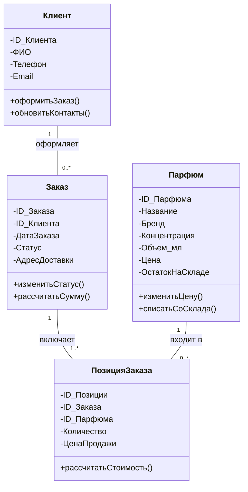

# 🌸 Парфюмерный магазин «ParfumShop» — Проектирование базы данных

Информационная система для автоматизации учета парфюмерной продукции, управления клиентской базой и обработки заказов в специализированном интернет-магазине парфюмерии **«ParfumShop»**.

## 📋 Описание предметной области

Система предназначена для хранения актуального ассортимента магазина, регистрации покупателей и учета продаж. В базе данных фиксируются подробные характеристики каждого аромата (наименование, бренд, концентрация, объем флакона, цена и складской остаток), контактные данные клиентов, а также история заказов с детализацией купленных позиций.

Накопленные данные позволяют администрации магазина:

- Отслеживать популярность конкретных парфюмерных брендов и ароматов.
- Контролировать остатки флаконов и вовремя пополнять склад.
- Отслеживать статусы доставки заказов.
- Рассчитывать общую выручку магазина за любой период.

## 📐 Визуальная ER-диаграмма базы данных

## 🗂 Структура базы данных (Сущности и атрибуты)

В ходе проектирования были выделены **4 основные сущности**, между которыми настроена ссылочная целостность:

| Сущность | Атрибуты (PascalCase) | Тип данных (Access) | Описание |
| :--- | :--- | :--- | :--- |
| **Клиент** | `ID_Клиента` (PK) `ФИО` `Телефон` `Email` | Счетчик Короткий текст Короткий текст Короткий текст | Уникальный код клиента Фамилия, имя и отчество покупателя Контактный номер телефона Электронная почта для чеков и уведомлений |
| **Парфюм** | `ID_Парфюма` (PK) `Название` `Бренд` `Концентрация` `Объем_мл` `Цена` `ОстатокНаСкладе` | Счетчик Короткий текст Короткий текст Короткий текст Числовой Денежный Числовой | Уникальный артикул товара Наименование аромата Парфюмерный дом / производитель Тип (EDP, EDT, Extrait, одеколон и т.д.) Объем флакона в миллилитрах Актуальная стоимость единицы товара Доступное количество на складе |
| **Заказ** | `ID_Заказа` (PK) `ID_Клиента` (FK) `ДатаЗаказа` `Статус` `АдресДоставки` | Счетчик Числовой Дата и время Короткий текст Короткий текст | Уникальный номер заказа Внешний ключ (связь с таблицей `Клиент`) Дата и время оформления заказа Текущий статус («Новый», «Оплачен», «Доставлен») Адрес курьерской доставки или ПВЗ |
| **ПозицияЗаказа** | `ID_Позиции` (PK) `ID_Заказа` (FK) `ID_Парфюма` (FK) `Количество` `ЦенаПродажи` | Счетчик Числовой Числовой Числовой Денежный | Уникальный код строки в чеке Внешний ключ (связь с таблицей `Заказ`) Внешний ключ (связь с таблицей `Парфюм`) Количество флаконов в заказе Цена аромата, зафиксированная на момент покупки |

## 🔗 Логика связей и нормализация

- **Клиент — Заказ (`1:N`):** один покупатель может оформить множество заказов, но каждый конкретный заказ принадлежит строго одному клиенту.
- **Заказ — ПозицияЗаказа (`1:N`):** один заказ может включать в себя множество разных позиций парфюмерии, но каждая строка чека относится только к одному заказу.
- **Парфюм — ПозицияЗаказа (`1:N`):** один и тот же аромат может встречаться в разных заказах покупателей, но в конкретной позиции заказа указан строго один товар.

**Разрешение связи «Многие-ко-многим» (`M:N`):** логическая связь между сущностями `Заказ` и `Парфюм` (в одном заказе много ароматов, и один аромат покупают в разных заказах) успешно разрешена с помощью ассоциативной сущности **ПозицияЗаказа**, которая разбила её на две связи типа `1:N`.

## 🛠 Используемые инструменты

- **draw.io (diagrams.net)** — проектирование логической ER/UML-диаграммы классов.
- **Mermaid.js** — встроенная визуализация ER-диаграммы в документации репозитория.
- **Microsoft Access** — физическая реализация таблиц, настройка связей, создание запросов, форм и отчетов.

